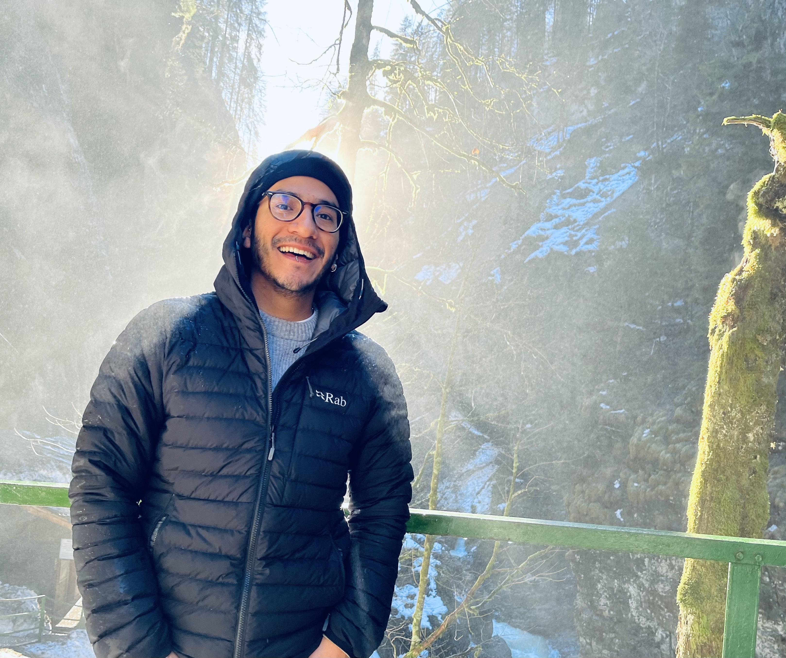

<h2>  About me  </h2>

I am a Research Fellow at the Mathematics Institute, [University of Warwick](https://warwick.ac.uk/fac/sci/maths/) working with [Ric Wade](https://warwick.ac.uk/fac/sci/maths/people/staff/Wade). I started this position as a Postdoctoral Research Associate at the Mathematical Institute, [University of Oxford](https://www.maths.ox.ac.uk), before moving to Warwick together with Ric Wade. 

I completed my PhD at the [Karlsruhe Institute of Technology](https://www.math.kit.edu/english/) in Germany under the supervision of [Claudio Llosa Isenrich](https://www.claudiollosa.com). <!--Before that I did my Master's at the University of Bonn where I wrote my master's thesis under the supervision of [Ursula Hamenstädt](https://www.math.uni-bonn.de/people/ursula/). I obtained my Bachelor's at the National Autonomous University of Mexico (UNAM).-->

I am one of the organisers of the Warwick [Geometry and Topology seminar](https://warwick.ac.uk/fac/sci/maths/research/events/seminars/areas/geomtop/).

<h2> Research interests </h2> 

I use topological, combinatorial, and geometric techniques to study infinite groups. My research interests include automorphisms of non-positively curved groups, the geometry of their subgroups, and the quasi-isometry classification of nilpotent groups. The Dehn function of a group has plays a central role in my work across these areas.

I wrote a [short text](https://www.maths.ox.ac.uk/node/74266) about Dehn functions and one of my papers aimed at a large mathematical audience. 

For further information, see my <a href="CV/cv-GarciaMejia.pdf">CV</a>.

<small><i>Note: My official name is Jerónimo García Mejía. For publications, I go with Jerónimo García-Mejía. </i></small>

