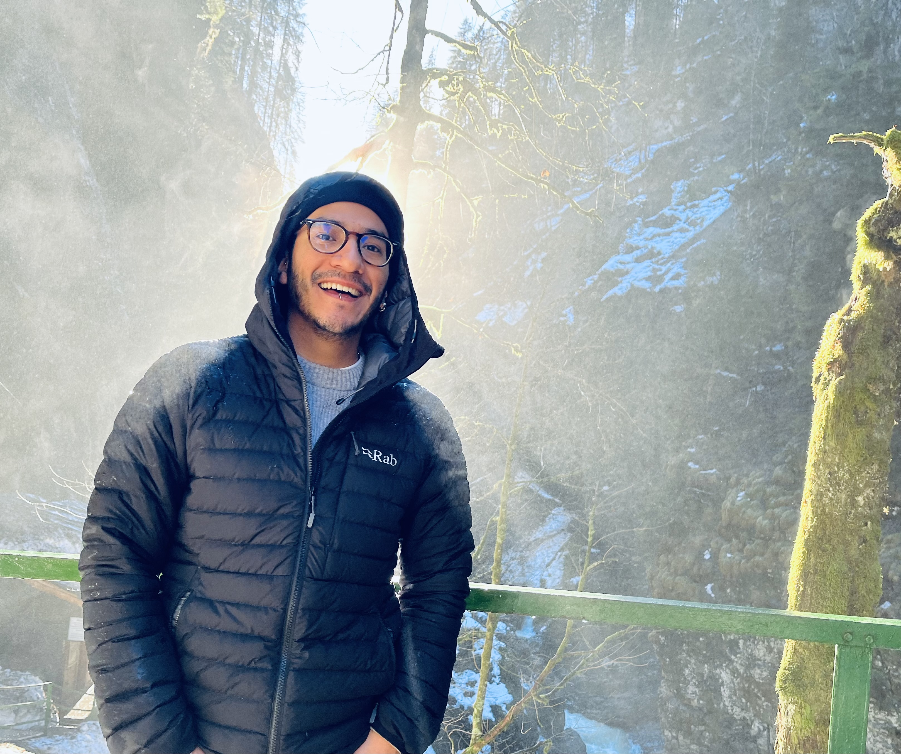

<h2> About me </h2> 

I am a Research Fellow at the Mathematics Institute, [University of Warwick](https://warwick.ac.uk/fac/sci/maths/) working with [Ric Wade](https://warwick.ac.uk/fac/sci/maths/people/staff/Wade). I started this position as a Postdoctoral Research Associate at the Mathematical Institute, [University of Oxford](https://www.maths.ox.ac.uk), before moving to Warwick together with Ric Wade. 

I completed my PhD at the [Karlsruhe Institute of Technology](https://www.math.kit.edu/english/) in Germany under the supervision of [Claudio Llosa Isenrich](https://www.claudiollosa.com). <!--Before that I did my Master's at the University of Bonn where I wrote my master's thesis under the supervision of [Ursula Hamenstädt](https://www.math.uni-bonn.de/people/ursula/). I obtained my Bachelor's at the National Autonomous University of Mexico (UNAM).-->

I am one of the organisers of the Warwick [Geometry and Topology seminar](https://warwick.ac.uk/fac/sci/maths/research/events/seminars/areas/geomtop/).

<b>On AI:</b> I do believe that tools, such as AI, can be beneficial for science and other fundamental aspects of life. Nevertheless, I find it worrying that most AI tools, as of today, are not easily accessible in the same way to everyone, and are rather controlled by companies whose sole interest is to maximise their profits, while engaging in questionable working and ethical practices.

<h2> Research interests </h2> 

I study infinite groups from a geometric perspective. I use topological, combinatorial, and geometrical techniques to understand groups. My research area is within Geometric Group Theory. I am particularly interested in automorphisms of non-positively curved groups, as well as the geometry of their subgroups, and the quasi-isometry classification of nilpotent groups.

I wrote a short text about Dehn functions and one of my recent works aimed at a large mathematical audience. This can be found [here](https://www.maths.ox.ac.uk/node/74266). 

For further information, see my <a href="CV/cv-GarciaMejia.pdf">CV</a>.

<small><i>Note: My official name is Jerónimo García Mejía. For publications, I go with Jerónimo García-Mejía. </i></small>

